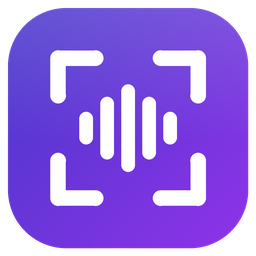
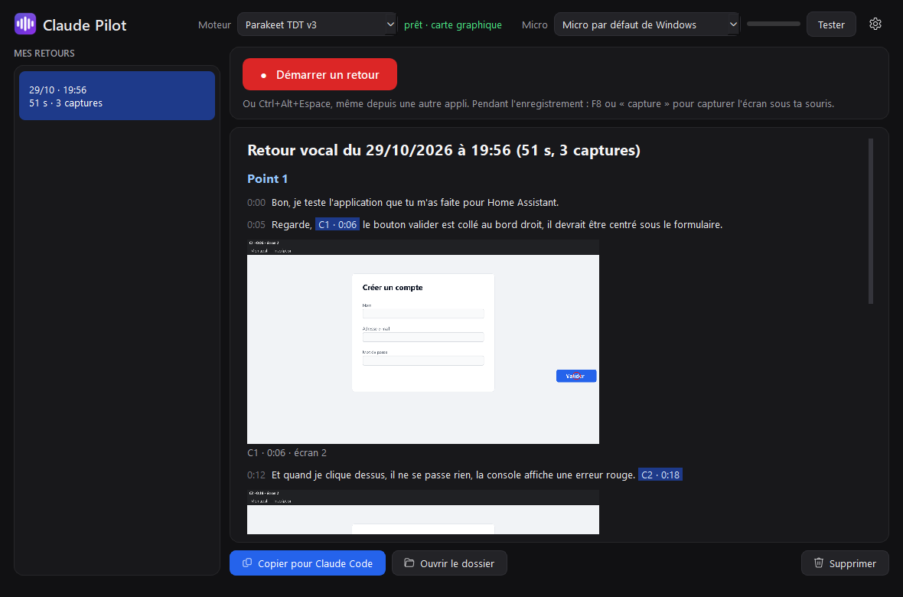
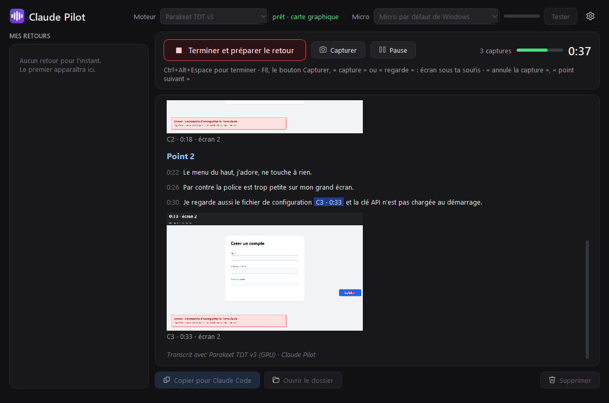
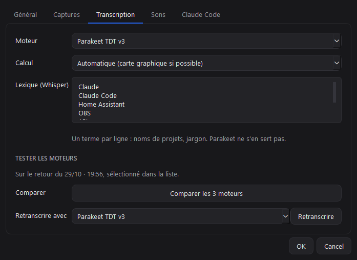

<div align="center">



# Claude Pilot

Fais tes retours à **Claude Code** en parlant, comme en partage d'écran : ta voix est transcrite et chaque capture d'écran tombe pile au bon moment de la phrase.

[**⬇ Télécharger pour Windows**](https://github.com/StundZow/claude-pilot/releases/latest/download/Claude-Pilot-Setup.exe) · [Releases](https://github.com/StundZow/claude-pilot/releases)



</div>

## Ce que ça fait

Quand Claude Code te construit une appli, le plus long, c'est de lui expliquer ce qui ne va pas : écrire, faire des captures, les coller dans le bon ordre, préciser « sur la troisième capture, le bouton en bas à droite »…

Avec Claude Pilot, tu appuies sur un raccourci et tu parles en montrant ton écran. Pour montrer quelque chose, tu dis « regarde » ou « capture », ou tu appuies sur `F8`. L'écran sous ta souris est alors capturé, ta souris y est entourée en rouge, et la capture se place au mot près dans la transcription. À la fin, un seul message est copié : tu le colles dans Claude Code, qui lit tout le retour, captures comprises.

## Pourquoi pas juste des captures et du texte ?

Parce qu'un chat mélange l'ordre des images, limite leur nombre (20 par message sur claude.ai) et oblige à tout réécrire à la main. Ici, chaque capture porte son numéro et son moment (`[C2 · 0:31]`), dans l'image comme dans le texte. Claude ne peut pas se tromper de correspondance, même avec quarante captures, et tu n'as rien à taper.

## Fonctionnalités

- 🎙️ **Transcription locale et stable**, phrase par phrase : rien ne part sur Internet. Trois moteurs au choix (Parakeet TDT v3 par défaut, Whisper large-v3, Whisper turbo), sur carte graphique NVIDIA ou sur processeur
- 📸 **Captures au bon mot** : raccourci `F8`, bouton, ou à la voix (« capture », « regarde »…). Une « boîte noire » garde les dernières secondes d'écran : la capture dite à voix haute prend l'image du moment exact du mot
- 🖱️ **Ta souris entourée** sur chaque capture, et seulement l'écran où elle se trouve : tout reste lisible, même avec trois écrans
- 🗣️ **Commandes vocales** : « annule la capture », et « point suivant » pour découper ton retour en sections
- 🪟 **Barre flottante** pendant l'enregistrement, invisible dans les captures
- 📝 **Transcription en direct** dans la fenêtre, avec les miniatures, et l'historique de tous tes retours
- 🤖 **Prêt pour Claude Code** : message copié à l'arrêt (`Ctrl+V`), ou commande `/retour` en option
- 🔊 **Bruitages discrets** pour suivre chaque action sans regarder l'écran
- 🔄 **Mise à jour automatique** intégrée, avec le changelog

<div align="center">

&nbsp;&nbsp;

<br><br>

</div>

## Prise en main

1. [Télécharge `Claude-Pilot-Setup.exe`](https://github.com/StundZow/claude-pilot/releases/latest/download/Claude-Pilot-Setup.exe) et lance-le. Pas besoin d'être administrateur.
2. Garde ou change le dossier d'installation, coche les raccourcis voulus, puis **Installer**. La première fois, l'installateur télécharge Python, les composants (≈ 2 Go) et le moteur de transcription (2,5 Go) : compte quelques minutes.
3. Dans Claude Pilot, clique sur **Tester** à côté du micro et parle : la jauge doit bouger. Sinon, choisis un autre micro dans la liste.
4. Clique sur **Démarrer un retour**, ou appuie sur `Ctrl+Alt+Espace` depuis n'importe quelle appli. Parle, capture avec `F8` ou en disant « capture », puis termine avec `Ctrl+Alt+Espace`.
5. Dans Claude Code : `Ctrl+V`, puis Entrée.

**Configuration conseillée** : Windows 10 ou 11, carte graphique NVIDIA (sinon, tout tourne sur le processeur, plus lentement), environ 6 Go d'espace disque.

## Comment ça marche

**Installation et mises à jour.** L'installateur n'embarque pas l'appli. Il télécharge la dernière version depuis les releases GitHub, installe un Python privé et les composants avec [uv](https://github.com/astral-sh/uv), télécharge le moteur de transcription, puis crée les raccourcis et l'entrée « Applications installées ». L'appli vérifie les nouvelles versions à chaque lancement et propose la mise à jour avec son changelog. Une mise à jour ne retélécharge que le code, plus les composants qui ont changé.

**Transcription.** Un détecteur de voix (Silero) découpe le micro à chaque pause : chaque phrase est transcrite une fois pour toutes, donc le texte ne bouge plus et le retour est prêt une à deux secondes après l'arrêt. L'audio est enregistré en continu sur le disque et sert d'horloge unique : les mots et les captures ne peuvent pas se décaler, et on peut retranscrire un retour avec un autre moteur (Réglages → Transcription).

**Ce que reçoit Claude.** Chaque retour est un dossier dans `Documents\Claude Pilot\retours` :

- `retour.md` : la transcription horodatée, les marqueurs `[Cn · m:ss]` et la liste des captures ;
- `C1_0m12s.png`… : les captures, avec leur bandeau d'étiquette, réduites à 2000 px pour rester lisibles par Claude ;
- `audio.flac` : l'enregistrement, pour retranscrire quand tu veux.

Claude Code lit les captures lui-même, une par une : la limite d'images par message des chats ne s'applique pas.

| Moteur | Sur l'audio de test (49 s, RTX 5080) |
|---|---|
| **Parakeet TDT v3** (défaut) | 0 % d'erreur, même avec du bruit · 69× plus rapide que le temps réel · n'invente rien sur un silence |
| Whisper large-v3 | Aussi juste · 10× le temps réel · peut inventer une fin de phrase si l'audio est coupé |
| Whisper large-v3 turbo | 32× le temps réel · a inventé « Merci. » sur un silence (filtré depuis) |

## Lancer depuis les sources

```bash
uv sync
uv run python -m claudepilot
```

Outils de développement : `uv run pytest` (tests), `tools/bench_engines.py` (banc d'essai des moteurs), `tools/simulate_session.py` (retour complet simulé, sans micro), `tools/snapshot_ui.py` (photos de chaque écran), `tools/check_overlay.py` (barre invisible dans les captures).

## Publier une nouvelle version (pour les mainteneurs)

```bash
uv run python release.py 1.0.1
```

Ajoute d'abord une section `## 1.0.1` dans [CHANGELOG.md](CHANGELOG.md) : c'est le texte que l'appli affiche quand elle propose la mise à jour. Le script reconstruit l'installateur et le code de l'appli, tague la version et publie la release. Il nécessite [GitHub CLI](https://cli.github.com/) authentifié.

## Crédits

Moteurs : [Parakeet TDT 0.6B v3](https://huggingface.co/nvidia/parakeet-tdt-0.6b-v3) (NVIDIA, CC-BY-4.0, version ONNX via [onnx-asr](https://github.com/istupakov/onnx-asr)), [Whisper](https://github.com/openai/whisper) (OpenAI) via [faster-whisper](https://github.com/SYSTRAN/faster-whisper), détecteur de voix [Silero VAD](https://github.com/snakers4/silero-vad). Interface : Qt / PySide6.

Projet indépendant, sans lien avec Anthropic. « Claude » et « Claude Code » sont des marques d'Anthropic.
